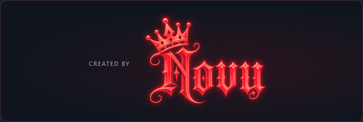
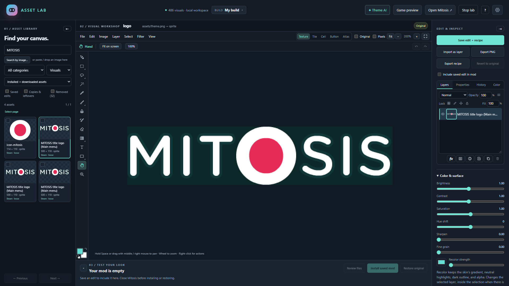
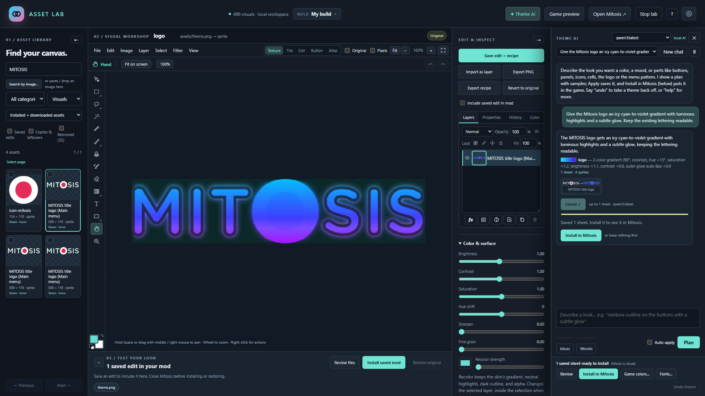
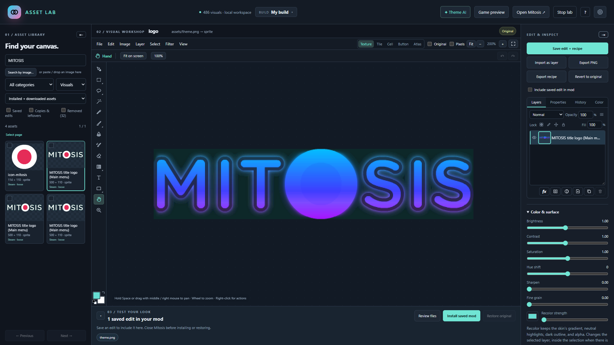
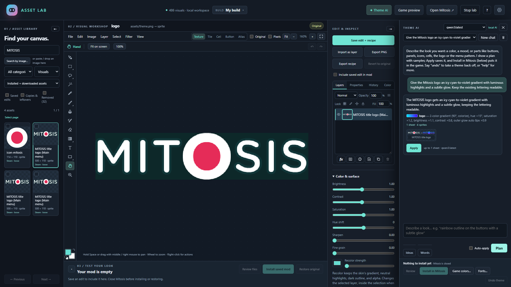
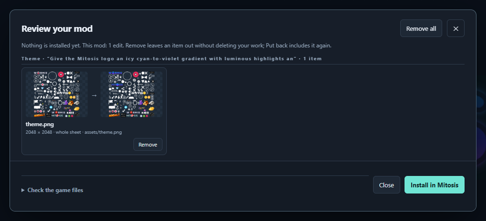

# Asset Lab

A local visual editor and theme maker for **Mitos.is: The Game** (Steam). Repaint any sprite, theme the whole game from
a prompt, or redraw art with a local image model, then install your mod and restore the originals with one click.
Everything runs on your own PC.

## From original artwork to your own theme

### 1. Find the asset

The original **MITOSIS main-menu title**, opened from the game's sprite sheet. Browse and search on the left,
work on the canvas in the center, and manage layers and adjustments on the right. Both sidebars can collapse
when you need more room.



### 2. Describe the look in Theme AI

> Give the Mitosis logo an icy cyan-to-violet gradient with luminous highlights and a subtle glow.
> Keep the existing lettering readable.

Theme AI turns the request into a plan and previews the change. **Apply** saves it to the workspace;
installation remains a separate step. The capture below shows the applied result alongside its conversation.



### 3. Inspect the finished artwork

The same title after applying the theme, with the chat panel closed for a clear view of the result.



<details>
<summary>See the plan and before/after review</summary>



Compare original and edited artwork before installing. Remove an item from the mod without deleting your work.



</details>

These are unretouched captures of a real Theme AI workflow in a separate demonstration workspace, using copies of
Mitosis game artwork. No changes were installed into the game for these screenshots. The desktop version uses the
same editor inside its own Windows window with native window controls.

## Get started

1. Download **AssetLab.exe** from the latest [release](../../releases/latest) and run it.
2. The first start sets itself up in `%LOCALAPPDATA%\AssetLab` (about 30 MB: a portable Python with numpy and Pillow).
3. It offers the optional local AI (about 6.3 GB): the smart Theme AI planner and image redesigns. You can skip it and
   download it later. It needs 16 GB of RAM; a graphics card with 6 GB or more makes an image take about 35 seconds.
4. Setup gives way to the Asset Lab desktop window. Closing that window stops the local backend; no browser tab or
   separate bootstrapper needs to stay open. On PCs without WebView2, setup offers to install Microsoft's runtime.

Asset Lab finds your Mitos.is installation through Steam. It never needs administrator rights.

## What it does

- **Library:** every sprite, sheet, font glyph and background in the game, with search, categories, favorites, your
  own names for assets, image search ("find similar"), and a removed-assets pool for things you never want to see.
  The menus' parts come named (Play button, Ranks button icon, Discord button...; ask Theme AI "what can I change?"),
  and art the game never shows is already out of the pool.
- **Editor:** layers, selections, brushes, fill, text and shapes, transforms, filters, layer styles, color adjustments,
  undo/history and PNG export. Collapse the sidebars or widen the canvas, and preview as a texture, tile, cell or button.
- **Theme AI:** describe a look ("rainbow neon outlines with a subtle glow", "holographic glass panels", "dark ocean
  theme, keep the logo", "make everything spooky") and review a plan with before/after samples before anything is
  saved. Moods like spooky, christmas, winter, royal or cyberpunk have matching palettes. Name one part to change just
  that ("make the play button gold"), or "hide the discord button" (also the App Store and Google Play badges and the
  OG tag). Check assets in the library to theme only those. Say "undo" to take the last theme off, or "help".
- **Game-colored icons:** most menu icons are white pictures that the game colors itself (teal, or pink for the
  arrows). Previews show them the way the game will draw them, so a gold crown that would come out green is no surprise.
- **Redesign (local AI):** "make the title spooky with dripping blood and bats", "put a party hat on the logo", "make
  the icons look like gold coins". The local language model first writes an art direction, then the image model
  draws a few variants; pick one, adjust its size and position, keep the original outline if the game stretches it,
  refine it with a follow-up, then apply. A group is redrawn one sprite at a time in one shared style. "Make the title
  say MITOSIS 2" changes the words; "turn the coin into a diamond" redraws the coin. For a game-colored icon, **Keep it
  white** turns the drawing into white-and-gray detail, so it takes the game's color instead of mixing with it.
- **Both at once:** "christmas theme and put a santa hat on the title" shades the palette and redraws the title.
- **Review and install:** see every change before and after, take any item out, install into the game, and update an
  installed mod without restoring first. **Restore original** puts the exact original files back.

## Updates and your data

Asset Lab checks for a newer release when it starts and asks before updating. Your work lives in your user folder
(`%USERPROFILE%\AssetLab`), separate from the app, and is never replaced by an update; the settings files are backed up
to `%LOCALAPPDATA%\AssetLab\backups` before each update.

Both update downloads are checked before activation. An interrupted update keeps the launcher executable in place;
the next start recovers the previous app or finishes the new version, depending on whether the launcher replacement
completed. The previous app version is retained. Closing the editor dismisses the window after any unsaved-edit
confirmation, then finishes backend shutdown; an active theme, drawing, or sound job keeps the app open with an explanation.

## Good to know

- Close Mitos.is before installing or restoring; Asset Lab offers to close it for you.
- Executable edits are disabled in this build: changed executables exited during local testing. This does not establish
  the game's internal protection mechanism. Asset Lab's supported workflow edits visual and audio assets.
- Steam may replace modded files when the game updates. Use **Restore original** before an update, or **Clear stale
  install** if Steam already replaced them.
- Share mods only from people you trust; never run downloaded executables you have not checked.

## Building from source

Requires Windows with the .NET Framework 4.8 compiler (included with Windows) and Python 3.13 with numpy and Pillow.

```powershell
python -m pip install numpy==2.5.4 pillow==12.3.0
$env:PYTHONPATH = 'src;tests'; python -B -X utf8 -m unittest discover -s tests
./tools/build_release.ps1          # dist\AssetLab.exe and dist\asset-lab-app.zip
```

The build downloads the pinned, checksum-verified WebView2 SDK from NuGet and embeds its managed assemblies and x64
loader in the EXE. The installed WebView2 Evergreen Runtime supplies the desktop renderer. `--no-browser` remains
available for backend-only development. Run `python -B -X utf8 -m unittest discover -s tests/browser -v` for the Edge
interaction suite before releasing.

Desktop packaging check (uses a fake game and separate workspace):

```powershell
./tools/test_desktop.ps1 -Python python
# To test the EXE outside the checkout using a copy of an installed portable runtime:
./tools/test_desktop.ps1 -Python python -PortablePython "$env:LOCALAPPDATA\AssetLab\python"
# Empty installation, with a fresh download of the pinned Python dependencies:
./tools/test_desktop.ps1 -Python python -CleanInstall -Screen 0
# Repeat display/layout/shutdown checks on the other monitor:
./tools/test_desktop.ps1 -Python python -Screen 1
# Real process-kill, corrupt-package, file-lock and saved-data recovery tests, all isolated:
python tools/test_update_recovery.py --python-home "$env:LOCALAPPDATA\AssetLab\python"
```

`-CleanInstall` tests an empty app installation on the current PC; it still uses that PC's installed Windows and
WebView2 runtime. A clean Windows VM is needed to validate missing-runtime setup. Desktop tests write close timings,
layout checks and screenshots under `local-only`, and update tests use only a loopback release server and a fake game.

The custom title bar keeps Windows moving, resizing, minimize/maximize, and Snap hit targets. Drag the title bar to
an edge or use Win+Arrow to arrange the editor alongside another window. Windows 11 can offer Snap Layouts over Maximize
when enabled in Windows settings.

Every push to `main` builds a release through GitHub Actions (`.github/workflows/release.yml`), numbered
`<VERSION>.<run number>`.

Asset Lab is a fan-made tool and is not affiliated with the developers of Mitos.is. Licensed under the MIT License;
the downloaded components keep their own licences (see [THIRD-PARTY-NOTICES.md](THIRD-PARTY-NOTICES.md)).
