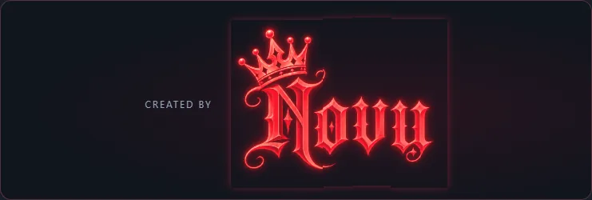
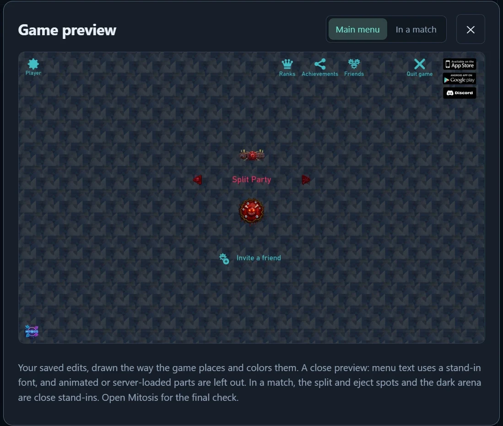
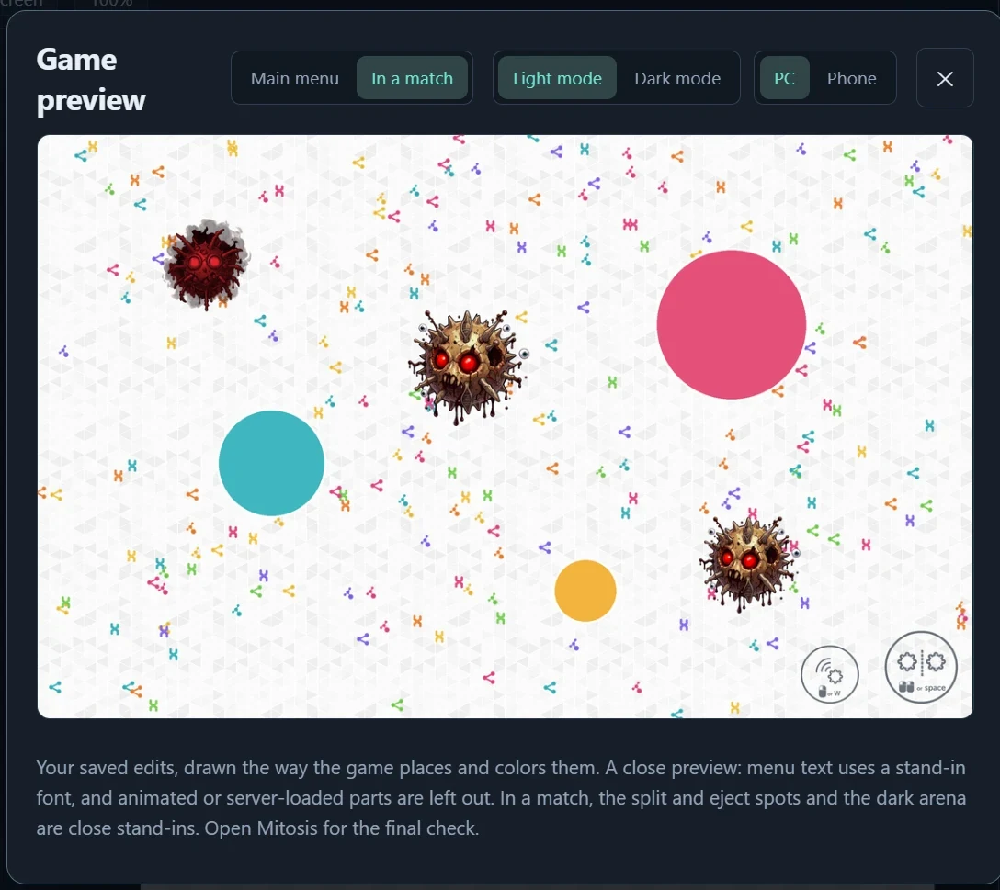
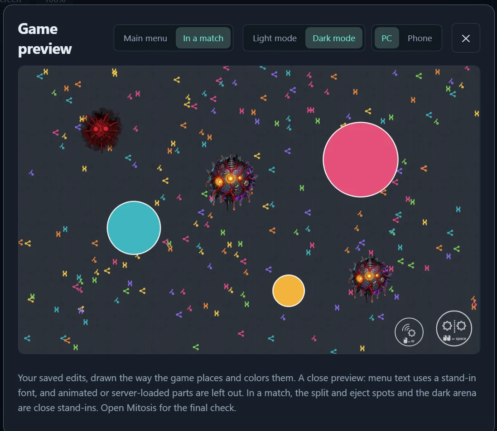

# Asset Lab

**Make Mitos.is look your way.**

Asset Lab is a Windows desktop editor for the artwork and sounds in **Mitos.is: The Game**. Find an asset, edit it by hand or describe a new look to Theme AI, then review your changes before installing them.

**Presets → Community themes** contains curated theme bundles with creator credit. TRON, credited to Delta, includes a seamless grid, identity-disc viruses, menu and in-game controls, three interchangeable food designs, and a matching MITOSIS title. Preview the parts, choose artwork for each food slot, and create a separate theme build before applying it to the game. Individual foods also retain the usual all-foods or single-food placement controls.

[**Download Asset Lab**](https://github.com/xXrisingXx/asset-lab/releases/latest)

### How to download and run it

1. Open the [**latest release**](https://github.com/xXrisingXx/asset-lab/releases/latest).
2. Scroll down to **Assets** and click **AssetLab.exe**. Only that file:
   - **Source code (zip)** is the code, not the program.
   - **asset-lab-app.zip** is downloaded by Asset Lab itself.
3. Open your **Downloads** folder and **double-click AssetLab.exe**. If your browser asks whether to keep the file, choose **Keep**.
4. If Windows says **"Windows protected your PC"**, click **More info**, then **Run anyway** (why: see *Is it safe?* below).
5. Follow the short setup: Asset Lab finds Mitos.is from Steam and opens its window. The AI download is optional; you can skip it.
6. To open Asset Lab again later, double-click **AssetLab.exe** again (move it to your Desktop to find it easily).

You need a 64-bit Windows PC with **Mitos.is: The Game** installed from Steam.

> **Is it safe?** Asset Lab is open source: every line is in this repository. `AssetLab.exe` is built on GitHub's servers from this code, never on anyone's PC, and each release carries a [build attestation](https://github.com/xXrisingXx/asset-lab/attestations) that proves it. Each release's notes also give the file's SHA-256 and a VirusTotal link for that exact file.
>
> Windows shows **"Windows protected your PC"** because the app is new and not code-signed yet. Click **More info › Run anyway**. Asset Lab does not need administrator rights, installs into your own user folder, backs up every game file before changing it, and **Restore original** puts them back exactly. See [Privacy](#privacy) for everything it connects to.

## Features

| Feature | What you can do |
| --- | --- |
| **Simple and Advanced** | **Simple** is just the pictures and Theme AI: click what you want to change, say how, install. **Advanced** adds the full image editor. New players start in Simple; switch any time in the top bar. |
| **Asset library** | Search sprites, textures, backgrounds, fonts and sounds. Use categories, favorites, custom names and image similarity search to find what you need. |
| **Layered editor** | Paint, erase, select, fill, add text and shapes, transform artwork, adjust colors, apply filters and layer effects, and export PNGs. |
| **Theme AI** | Describe a look in your own words: colors, gradients, outlines, glow, a mood or a whole theme. Preview the plan before applying it to one asset, a checked selection or the whole game. |
| **Themes from real pictures** | Name something (“a BMW theme”, “a Post Malone theme”) and Theme AI looks up pictures of it, so the art uses its real emblem, colors and style instead of guessing from words. |
| **AI image generation** | Redraw any art: “turn the coin into a diamond”, “make the food little tires”, “give the virus a santa hat”, or right-click a picture › **Redraw with Image AI**. Compare variants, adjust the fit and apply the one you like. Requires the optional local AI download. |
| **Whole-game redraw** | One request redraws what players care about: the menu and arena backgrounds, the viruses, the menu buttons, the in-game buttons and the three foods (anything else, like the title or the coin, by name). A queue shows every piece large, lets you leave pieces out, pick how many variants each gets and the order, and shows the finish time. |
| **Accelerate** | One click uses the whole graphics card and every processor core for faster drawings (the PC is slower while it draws). |
| **Your pictures and presets** | Paste or drop any picture into Theme AI and say “make this dark blue”: the main color changes and the light and shade stay. **Presets** is a window of ready-made art by category: 100 seamless backgrounds, 100 viruses (the classic virus in 25 colors, wild creatures like a unicorn, dragon or knight…), 120 foods and collectibles (13 classic ones that match the classic viruses, a dragon egg, a galaxy donut, a rubber duck…), **menu button sets** (100 looks with their own exotic button, from gold medallions to lava rocks, 13 classic ones, 20 fully redrawn sets and the flat originals), matching **in-game button sets** for phone and PC, and 113 **titles** (60 fully redrawn by Image AI, like a spooky one with pumpkins and bats). **Clean up** hides the Discord button, the store badges and the OG tag. Click one to see it big, **Use** to pick it, pick one of each kind and **Use all**. Right-click a picture to **export** it, or a category to export all of it as a zip or a folder; backgrounds export as the game's own files, named and sized to drop in. |
| **Fonts and new fonts** | Restyle the game's text in any font with gradients, outlines, glow and shadow, or ask Theme AI for a brand-new one: “a font made of lava”, “letters covered in sprinkles”, “a new font for a pirate ship”. Image AI draws what the letters are made of and the letters stay readable. |
| **Sounds** | Replace or edit sounds, with trimming, fades, looping and volume controls. |
| **Game preview** | See the menu and a match with your mod, in light and dark mode, with the game's controls. |
| **Flexible workspace** | Collapse either sidebar or widen the canvas. Preview artwork as a texture, tile, cell or button. |
| **Builds and saved work** | Keep different mod builds and switch between them. Each build keeps its own Theme AI chats, which you can search, rename and reopen. |
| **Review and restore** | Compare original and edited artwork, exclude individual changes, update an installed mod and restore the original files. |
| **Suggestions** | Send ideas and bug reports straight to the creator from **Settings › About**. |

## What's new

- **Draw with your own pictures.** Attach up to 4 pictures and ask for something specific: "make the virus the Norway flag with these goggles on top and this mustache below". Image AI uses your pictures as references, so it draws the real thing, and when a request names a country's flag it gets the exact flag as a reference too (86 flags), instead of guessing it.

- **Fonts in Presets: 150 text styles.** A new **Fonts** tab: 50 made by Image AI (letters of lava, marble, galaxy, candy, dragon scales…), 13 **Classic virus** styles that glow like the classic viruses, clean ones like the game's friend list, **Black in white fog**, and every Text & fonts look. See one on your own name, pick which text it changes (player names, menu text…), then **Use now**, or **Fine-tune…** it in Text & fonts.
- **Restyled fonts match the game's own layout.** Every character, even the space, now gets a real spot on a square letter sheet, like the game's own fonts (a player's game crashed with a restyled font).

- **Presets: customize, then Use now.** Click a preset to see it big and set it up right there: its color (a click, or type one), **where it goes** (the main menu, the game in light or dark mode, a virus's light or dark mode, phones or PCs), a background's strength, and a title's size. **Use now** puts it in your changes, no chat needed. Want a different background on the menu and in game, or for light and dark mode? Pick one for each place, then **Use all**. Typing something that isn't a color asks Theme AI about that preset.
- **Food 1, 2 and 3.** The game's three foods, smallest to biggest, shown with the game's own pictures: put a food on all of them or just one.
- **Whole titles.** The 60 creative MITOSIS titles now fit whole in the game (no more cut-off moons, crowns or flames), with a **Size** slider to make one bigger.
- **Fixes:** renaming a build works again; in Advanced, the AI activity no longer covers New chat. Presets is a labeled button again, and the tour shows it with how many presets there are.

- **Get the local AI from Settings.** Said "Not now" at the first start? Settings › Theme AI & drawing › **Get the local AI** downloads it (about 7 GB, one time, checked like the first-start download) while you keep working, and a stopped download continues where it stopped.

- **A simpler Simple mode.** The library on the left now shows only what players change, by the names they know (Play button, Coin icon, Game floor 2…) in big pictures and categories, one card per thing; what is checked stays in sight with an ✕ to uncheck. The chat starts with ideas to click, says what a request will change, and won't send a half-finished sentence. Clearer buttons: **Show me**, **Keep this**, **Apply to Game**, plus **Preview in game** and **Start fresh**. Simple works in a narrow window too.

- **A tidier Theme AI box.** One line of starters, then one box: 📎 your picture, 🖼 Presets and Aa Text & fonts sit beside what you type, with ⚡ Accelerate and **Show me** at the end. In Simple, Image AI is always on.

- **A safety net for every error.** If something stops Asset Lab from starting, it opens in **safe mode** instead of closing: it says what went wrong, and offers Try again, putting the game's original files back, and the error log. Errors anywhere else (a request, background work, the page) are caught so the lab keeps working, and all of them are kept in **errors.log** (Settings › About › Error log) for you to send to the creator.

- **Starts every time.** Asset Lab no longer stops at start when the game has a mod from another workspace (it opens that workspace, or lets you restore), when a record file was damaged (it uses its last good copy), or when the same folder was written differently. Restore original also works after Steam put the files back. A damaged or half-downloaded game file no longer stops it either ("File is not a zip file"): that file is left out with a note. If something does go wrong, the launcher now shows the actual cause and saves it to last-error.txt.

### Before that

- **Whole new menu buttons.** 100 looks, each with its own exotic button (a jeweled medallion, a jagged lava rock, an ice crystal, a pumpkin, a planet…) carrying the game's symbols, and the in-game buttons to match. 20 sets are fully redrawn, symbols and all: an arrow stays an arrow and points the way the game's does.
- **113 MITOSIS titles.** 60 fully redrawn by Image AI (spooky, frozen, molten, graffiti, pirate, space…), 40 in a look with that look's button as the O, and 13 classic ones that glow like the classic viruses.
- **Classic everything.** 13 classic button sets and titles to go with the 13 classic viruses, 13 more classic viruses in two-tone glows, and 13 classic foods in the same style.
- **Clean up:** one click hides the Discord button, the store badges or the OG tag (made see-through; the game itself is not changed).
- **More presets:** 100 backgrounds (a new Mitosis cells category, gaming, patterns, fantasy, underwater, sky and weather…) and 120 foods and collectibles (creatures, magic items, toys, treasure…).
- **All foods at once:** a food preset goes on all three of the game's foods in one go (or on just one), and the Presets tour shows it.
- **Theme AI:** More and Plan now sit on the line of starter buttons, at the right.
- **More of the game in every set:** the coin, Remove friend X, the SELL tag, and in a match the potion slot, the potion button and the chat button now take a set's look too (and a whole-game redraw includes them).
- **Presets open fast:** previews are drawn ahead and kept, so switching categories no longer waits.

### Before that

- **How to download and run it**, step by step, at the top of this page.
- **Menu and in-game button sets.** The first 40 looks (gold, chrome, gems, lava, ice, galaxy, candy, neon, obsidian…), each for the whole main menu and for the in-game buttons on phone (split, eject, joystick) and PC. Every button keeps its exact shape from your game, so they all match. Icons the game colors itself (the teal and pink ones) keep that color with the set's shine and outline.
- **Pick several presets, use them all.** Use picks a preset; pick a background, a virus, food and buttons, then **Use all** puts them all in the game.
- **40 wild foods** (dragon egg, galaxy donut, kitty mochi, lava cake, treasure cookie…) and **40 creative viruses** (unicorn, dragon, knight, octopus, clockwork…), plus the classic virus in 12 colors.
- **Export to share.** Right-click any preset or any edited picture in the chat › **Export**. Right-click a category (or a whole kind) to export all of it as a zip or a folder. Backgrounds can be exported as **game files**: the exact files they change, named as in the game, a folder for each background.
- **A first-time tour of Presets** shows all of this (open it again with **?**).
- **Fixes:** the Apply to Game review now always shows your newest change (it could show the previous picture).

### Earlier still

- **The Presets window.** 61 backgrounds, 41 viruses and 40 foods, by category. Click one to see it big with its changes, then Use; click any picture in the chat to see it big with its color and placement controls.
- **Apply to Game** shows what goes into the game first, then Apply to Game; **Restore original** shows what comes out first.
- **Simple for everyone** by default, with more room for the chat: chats on the title line, and the AI model, Accelerate and Your picture under More.
- **Simple mode.** New players get just the pictures and Theme AI: click what to change, describe it, install. Starter buttons (Colors, Whole theme, Background, Redraw something, Text & fonts) mean nobody has to know what to type, and the tour shows examples and the right-click menu.
- **Your own pictures and presets.** Paste a picture into Theme AI and say “make this dark blue”. Presets are ready-made viruses and about 60 seamless backgrounds to recolor and use; right-click one to make a whole theme from it.
- **AI-made fonts.** “A font made of lava” draws the material with Image AI and fills the letters of a real typeface with it; Theme AI also understands every way of asking about text (“change the nicktext font”, “make my name glow”, “use a different font”).
- **The same colors everywhere.** A theme's colors (“rainbow”, “red and gold”, or the colors of the first piece you apply) are the exact same shades in every drawing.
- **Fixes:** a font sheet is never redrawn as a picture any more (it came out as a block), and the Fonts window no longer waits forever while the PC's fonts load or an install runs.

### Earlier

- **Themes from real pictures.** Named themes look up pictures of the thing named, and every drawing takes its look from them (the BMW roundel becomes the O of MITOSIS).
- **About 5× faster drawings.** The same picture in about 25 seconds instead of 1½ minutes or more on an 8 GB laptop graphics card, plus the new **Accelerate** button.
- **Understands how you ask.** “The food should be little burgers”, “swap the food for tires”, “make the potion a beer bottle” and many other phrasings redraw the right part. A part it does not know is not guessed: Theme AI says so.
- **The three foods are drawn as three different foods**, each worth a different mass, with their small copies.
- **A real chat list** with search and renaming, and **suggestions** to the creator from Settings › About.
- **Steadier:** closing never hangs, long sessions no longer run out of network connections, and quick dialog clicks are no longer mixed up.
- **The red virus is tagged “Can't be changed”** (see below).

## See it in action

### The original game asset

The **MITOSIS main-menu title** in the editor. The library is on the left, the canvas is in the center, and layers and adjustments are on the right.

### A new logo generated with Theme AI

> Redraw the MITOSIS title as a completely new futuristic game logo, with bold beveled chrome lettering, cyan illuminated edges and a glowing cell forming the O. Keep the text MITOSIS clearly readable.

Theme AI's image-generation tool creates new artwork. Choose a variant, adjust its fit, and apply it to your workspace.

### The finished design

Close the chat panel to inspect the new logo on the larger canvas. Saving a design does not install it into the game.

### Backgrounds and the game preview

Ask Theme AI for a new background (“a city at night”, “BMW logos on carbon fiber”) and the image model draws it as a **seamless tile**: it wraps the picture around its edges while it draws, so the copies the game lays side by side meet with no visible seam. Move it with the sliders and it stays seamless; **Calmer** softens it so menu text stays readable.

**Game preview** shows your saved edits the way the game places and colors them: the main menu, and a match in light and dark mode, with PC or phone controls.

<table><tr>
<td></td>
<td></td>
</tr></table>

View the request and before/after review

## Get started

1. Download **AssetLab.exe** from the [latest release](https://github.com/xXrisingXx/asset-lab/releases/latest) (step by step: [How to download and run it](#how-to-download-and-run-it)).
2. Double-click it and follow setup. Asset Lab finds your Steam installation of Mitos.is and opens its own desktop window.
3. Choose whether to install the optional local AI. You can skip it and use the manual editor and keyword-based theme effects, and get it later in Settings › Theme AI & drawing › **Get the local AI**.
4. If setup asks for Microsoft's WebView2 runtime, follow the installation prompt so the desktop window can open.

You need a **64-bit Windows PC** and an installed copy of **Mitos.is: The Game**. The optional AI download is about **6.3 GB**. For local AI, **16 GB of RAM** is recommended; **32 GB is recommended for image generation**, which uses both system memory and graphics memory. A compatible graphics card with **6 GB or more of video memory** helps. Setup checks your hardware and available space. On an 8 GB laptop graphics card (RTX 4060) a drawing takes about 20–30 seconds, or 15–20 seconds with **Accelerate**; the first one takes longer while the models load, and speed varies by PC.

## Make your first mod

### Edit by hand

1. Search the library and select an asset.
2. Use the editor's tools and layers, or choose **Import as layer** to bring in your own image.
3. Preview the result and use undo or history to adjust your work.
4. Click **Save edit + recipe** to save the change to your mod.

### Use Theme AI

1. Open **Theme AI**. To limit a request, check the assets you want in the library first.
2. Describe the result. For example:
   - “Rainbow outlines on the buttons with a subtle glow.”
   - “Deep ocean blues, keep the logo.”
   - “Redraw the MITOSIS title as a futuristic chrome logo with cyan lighting.”
3. For color and effect changes, inspect the plan and preview, then click **Apply**.
4. For new artwork, click **Draw it**, click the variant you like and **Use this one** (**Adjust size and fit** has the fine controls).
5. Continue with another request or use the available undo controls if you want to try a different direction.

Be specific about the asset, colors and effect you want. Generated lettering and small details can vary, so inspect the preview before applying a design.

### Review and install

1. Open **Review** or **Review files** to compare the saved changes with the originals.
2. Use **Remove** beside anything you want to leave out. Your saved work stays available.
3. Close Mitos.is, or let Asset Lab close it when prompted.
4. Choose **Apply to Game**, check what goes in, then **Apply to Game** and launch the game to see the result.

**Apply and Save change your workspace. Install changes what the game uses.** You can keep editing an existing mod and install the updated version without restoring everything first.

## Restore the original game

Close Mitos.is and choose **Restore original**. Asset Lab restores the original files it backed up when installing your mod.

Steam updates can replace modified files. Restore originals before a game update when possible. If Steam has already replaced them, use **Clear stale install** when Asset Lab offers it, then review your mod before installing again.

## Keep your library organized

- **Favorite** assets you edit often so they are easy to find again.
- **Name** assets to make searches and Theme AI requests more specific.
- Use **Search by image** or **Find similar** to locate related artwork.
- **Remove from pool** hides unwanted assets from browsing and theme selection. Enable **Removed** to find and restore them later.
- Use separate **builds** to keep different looks organized.

## Updates and saved work

Asset Lab checks for updates when it starts and asks before installing one. Your builds, saved edits, favorites and settings are kept separately from application updates. If an update is interrupted, reopen Asset Lab so it can recover.

Open **Settings → About** to find your workspace and other saved-file locations. Before closing, finish any active drawing or sound task and respond to any unsaved-edit prompt.

## What can't be changed

Mitos.is downloads some art from its own server and replaces a changed copy before a match: **potions, power-ups, equipment and the red virus (the spawner)**. Edits to them do not show in the game, so Asset Lab tags them **Can't be changed** and Theme AI tells you when a request names them. Asset Lab does not try to get around this.

## Privacy

Asset Lab runs on your PC and has no accounts, ads or tracking. Your art, edits and requests stay on your PC. It only goes online for:

- **Setup and updates:** Python, the optional local AI and app updates (python.org, PyPI, Hugging Face, GitHub).
- **Theme inspiration:** when a Theme AI request names someone or something, only that name is looked up on Wikipedia and a few of its pictures are downloaded. You can turn this off in Settings.
- **Suggestions:** only what you type, and your Asset Lab version, when you press **Send**.
- **Links you paste** into the sound editor.

**Settings › Storage & privacy** lists every address the app uses.

## Support and feedback

- **Ideas and bugs:** Settings › About › **Suggestions** sends them straight to the creator.
- **Bug reports with details:** [open an issue](https://github.com/xXrisingXx/asset-lab/issues) and say what you did, what you expected and your Asset Lab version (Settings › About).

## Useful to know

- Local AI runs on your PC. Internet access is needed for setup downloads, updates and the features listed under Privacy.
- Some icons are colored or stretched by the game. Use the previews and **Keep it white** or **Keep the original shape** where offered.
- Asset Lab edits visual and audio assets. It does not change game logic, online systems or menu hitboxes; hiding an image does not necessarily disable its button.
- Use sound and image files you have permission to use, and keep a separate copy of work you do not want to lose.

---

Created by **Novu**. Asset Lab is a fan-made tool, not affiliated with the developers of Mitos.is. Mitos.is and its game artwork belong to their respective owners.

[License](LICENSE) · [Third-party notices](THIRD-PARTY-NOTICES.md)
